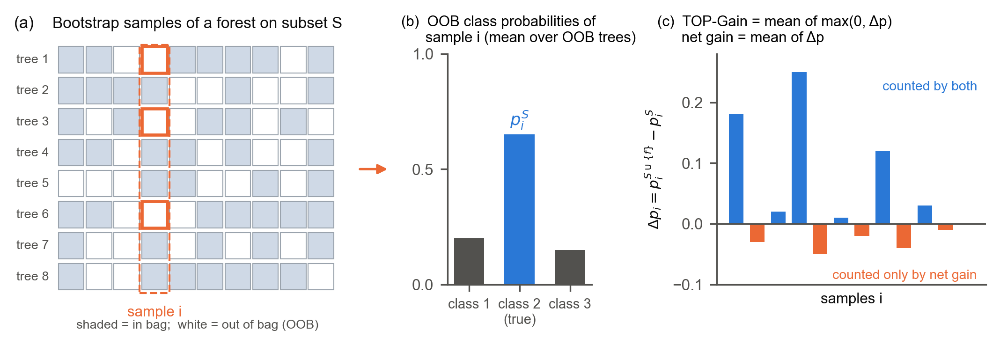

# TOP-Gain: Truncated Out-of-Bag Probability Gain

**A noise-robust criterion for Random-Forest wrapper feature selection.**

This repository contains the reference implementation of TOP-Gain and the complete code, raw results and pre-registration protocol of the paper:

> [Authors]. *Truncated Out-of-Bag Probability Gain: A Noise-Robust Criterion for Random-Forest Wrapper Feature Selection.* Submitted to *Knowledge and Information Systems*, 2026. [arXiv / DOI to be added]

---

## The idea

Forward wrapper selection with a Random Forest can use the **out-of-bag (OOB)** predictions of the forest as a free validation signal. Every instance $i$ is left out of about 37% of the bootstrap samples. Averaging the leaf class frequencies of those trees gives an honest estimate $p_i^S$ of the probability of the instance's **true class** under the feature subset $S$.

At every forward step, each candidate feature $f$ changes these probabilities by $\Delta p_i = p_i^{S\cup\{f\}} - p_i^S$. The usual criteria aggregate the per-instance changes, increases and decreases alike:

- the net gain $\frac{1}{N}\sum_i \Delta p_i$;
- the Brier score and log-loss;
- OOB accuracy.

With a modest forest, most of these per-instance changes are **estimation noise of either sign**, so the noise decides which of many near-equivalent candidates is added.

**TOP-Gain counts only improvements:**

$$
\mathrm{TOP\text{-}Gain}(f \mid S) \;=\; \frac{1}{N}\sum_{i=1}^{N} \max\!\left(0,\; p_i^{S\cup\{f\}} - p_i^{S}\right)
$$



**Why this helps.** Model the change of an instance that a candidate does not affect as pure noise, $\varepsilon \sim N(0,\sigma^2)$.

- The net gain receives the full noise variance $\sigma^2$, while TOP-Gain receives only $\operatorname{Var}(\max(0,\varepsilon)) \approx 0.34\,\sigma^2$. Truncation therefore removes about two-thirds of the noise of unaffected instances.
- Instances that a candidate truly improves ($\delta_i \gg \sigma$) are hardly affected, so the signal is kept.
- The small positive noise floor $\sigma/\sqrt{2\pi}$ is common to all candidates and cancels in the ranking.

**Main results of the paper.**

- **Pre-registered benchmark (26 OpenML-CC18 datasets, 15 methods).**
  - TOP-Gain has the best rank in ROC-AUC, accuracy and Macro-F1.
  - It is significantly better than 13 of 14 baselines.
  - It is on par with VSURF, which needs 21 times more single-core computation.
- **Controlled comparison inside an identical wrapper.** TOP-Gain selects more stable feature sets than the net gain, Brier, log-loss, OOB accuracy and OOB balanced accuracy, at equal or better accuracy.
- **Confirmatory study (24 further AutoML-Benchmark datasets).**
  - The advantage over all 12 baselines replicates.
  - As pre-registered, the stability gain grows as relevant features become sparser.

---

## Installation

The code was developed and run with Python 3.14 on Windows 11. Any recent Python 3.10+ should work.

```bash
pip install -r requirements.txt
```

**R baselines (optional).** varSelRF and VSURF are called through `Rscript`. They need R 4.x with the packages `randomForest`, `varSelRF` and `VSURF`. Set the path of `Rscript` and the R library folder with environment variables when they differ from the defaults in `exp_code/topg_baselines.py`:

```bash
export TOPG_RSCRIPT="/usr/bin/Rscript"           # default: C:\Program Files\R\R-4.6.1\bin\Rscript.exe
export TOPG_R_LIBS_USER="$HOME/R/topg-lib"       # default: ~/R/topg-lib
```

---

## Quick start

`exp_code/topg_top_gain.py` wraps the exact configuration used in the paper in a scikit-learn-style selector. It returns the same selections as the benchmark code; this was verified with and without the candidate pool.

```python
import sys; sys.path.insert(0, "exp_code")
from sklearn.datasets import make_classification
from topg_top_gain import TOPGainSelector

X, y = make_classification(n_samples=600, n_features=40, n_informative=6, n_redundant=4, random_state=0)

sel = TOPGainSelector(n_features=10, random_state=1).fit(X, y)
print(sel.selected_features_)    # ordered: the first k entries are the best panel of size k
X_small = sel.transform(X)       # the 10 selected columns
```

| Parameter | Default | Meaning |
|---|---|---|
| `n_features` | 10 | Number of features to select. The output is an ordered list, so one run gives nested panels for every smaller size. |
| `n_trees` | 40 | Trees of each surrogate forest. Accuracy is insensitive to it (20–160); stability increases with it (paper, Section 4.8). |
| `max_depth` | 5 | Depth of the surrogate trees. |
| `pool_factor` | 1.0 | Scales the candidate pool used when the data have more than 150 features. |
| `random_state` | 0 | Seed of the surrogate forests. |
| `n_jobs` | -1 | Parallel workers. The selection does not depend on this setting. |

A pandas `DataFrame` keeps its column names in `selected_features_`. `get_support()` returns a boolean mask over the columns.

---

## Repository layout

```
.
├── README.md
├── LICENSE                              # MIT (code); exp_result/LICENSE: CC BY 4.0 (data, docs)
├── requirements.txt
├── topg_dataset_selection_protocol.md   # pre-registration: dataset rules, moderators, hypotheses, amendments A1-A8
├── exp_code/                            # every script that produced a result of the paper
└── exp_result/                          # raw results and analysis outputs used in the paper, and the figures
```

All scripts are run from the `exp_code/` folder. They read from and write to `../exp_result/`. Datasets are downloaded from OpenML on first use; an internet connection is needed for that.

---

## Source code (`exp_code/`)

### Core modules (imported by the scripts)

| File | Content |
|---|---|
| `topg_top_gain.py` | `TOPGainSelector`, the scikit-learn-style interface shown above. |
| `topg_selector.py` | RF-OOB forward selector `SRAFSAblation`. TOP-Gain is its configuration `M6`; other flags implement the ablations. |
| `topg_run_wrapper_baselines.py` | The six wrapper criteria (TOP-Gain `M6`, net gain `M9`, log-loss `M10`, Brier `M11`, accuracy `M7`, balanced accuracy `M8`), the extension variants (`M4`, `M12`) and the original ten-dataset benchmark runner. |
| `topg_baselines.py` | The 14 baseline selectors (ANOVA, mRMR, JMI, ReliefF, Elastic Net, HSIC-Lasso, Stability Selection, Boruta, SVM-RFE, RF impurity, RF permutation, RF-RFE, varSelRF, VSURF) and the R bridge. |
| `topg_r_selectors.R` | Runs varSelRF and VSURF with package defaults and converts their output into a ranking. |
| `topg_common.py` | OpenML loading and preprocessing, the four downstream classifiers, Nogueira stability. |
| `topg_stats.py` | Dataset-level statistics: Friedman, Nemenyi CD, Holm-adjusted Wilcoxon, bootstrap CIs, CD diagrams. |
| `topg_synthetic.py`, `topg_ova_lung_data.py` | Synthetic data generators (XOR epistasis, class imbalance) and the OVA_Lung imbalance tiers. |

### Experiments and analyses

| Script | What it does | Output (in `exp_result/`) | Paper |
|---|---|---|---|
| `topg_dataset_screening.py` | Applies the eligibility rules R1–R3 and computes the moderators. Use `--suite 99` for CC18; use `--suite 271 --exclude-suite 99 --max-n 1000000 --out topg_screening_amlb.csv` for AMLB. | `topg_dataset_screening/topg_screening_cc18.csv`, `topg_screening_amlb.csv` | Table 1, Table S1 |
| `topg_run_cc18.py` | Main benchmark: 3 × stratified 5-fold CV, $K \in \{5,10,15,20\}$, 4 classifiers. The AMLB study uses the same script with `--screen …amlb.csv --outdir …/topg_amlb`. | `topg_cc18/topg_cc18_s<seed>_<dataset>.csv`, `topg_amlb/topg_cc18_s<seed>_<dataset>.csv`, `*/topg_cc18_errors.csv` | Sections 4.1–4.3 |
| `topg_analyze_cc18.py` | Pre-registered CC18 analysis: comparison with the baselines and criteria, hypotheses H1–H3, exploratory moderators. | `topg_cc18_analysis/topg_cc18_final_*.csv` | Tables 2, 3, 5; Fig. 3 |
| `topg_analyze_amlb.py` | Confirmatory analysis: H4a/H4b and the replication of the overall comparison. | `topg_amlb_analysis/topg_amlb_*.csv` | Tables 4, 5; Fig. 4 |
| `topg_runtime_benchmark.py` | Selection time of all 15 methods under one core and under ten cores (`--cores 1` / `--cores 10`). | `topg_runtime/topg_runtime_c1.csv`, `topg_runtime_c10.csv` | Table 6 |
| `topg_run_noise_analysis.py` | Ranking reliability of the six criteria under seed and data perturbations. | `topg_noise_analysis/topg_noise_scores_raw.csv`, `topg_noise_reliability.csv`, `topg_noise_summary.csv` | Table 7 |
| `topg_run_sensitivity.py` | Sensitivity to the surrogate configuration (`--part A`: T and depth on CC18; `--part B`: pool size on AMLB). | `topg_sensitivity/topg_cc18_s<seed>_<dataset>.csv` | Table 8 |
| `topg_analyze_sensitivity.py` | Analysis of the sensitivity study. | `topg_sensitivity_analysis/topg_sens_*.csv` | Table 8 |
| `topg_make_revision_tables.py` | Descriptive means, per-classifier ranks and dataset lists. | `topg_tables/topg_rev_{cc18,amlb}_{descriptive,per_classifier,datasets}.csv` | Tables 2, 4; Tables S1, S5 |
| `topg_make_revision_figures.py` | Toy simulation, runtime table, accuracy–stability–cost and H4b figures. | `topg_tables/topg_rev_toy_simulation.csv`, `topg_rev_runtime.csv`, figures | Figs. 2, 4, 5; Table 6 |
| `topg_make_v1_figures.py` | Final figures: OOB schematic, CD diagram, renumbering, TIFF copies. Run it after the previous script. | `figures/topg_fig1_…png` – `topg_fig5_…png` | Figs. 1–5 |
| `topg_run_repeated_cv.py` | Original ten-dataset benchmark with five repeats (seed 42 plus `--seeds 1 2 3 4`). | `topg_repeated_cv/topg_rep_s<seed>_<dataset>.csv` | Section S2 |
| `topg_stats.py --source repeated` | Statistics of the repeated original benchmark. | `topg_stats/topg_stats_repeated_*.csv` | Tables S2a, S2b |
| `topg_run_wrapper_baselines.py --variants M6 M4 M12 …` | Original benchmark, single seed 42: TOP-Gain, extensions, common-seed check. | `topg_benchmark/topg_<dataset>_summary.csv` | Section S4 |
| `topg_make_paper_tables.py` | Tables of the robustness and extension checks. | `topg_tables/topg_table_robustness_seed.csv`, `topg_table_extensions.csv` | Tables S4a, S4b |
| `topg_run_core_validation.py` | Synthetic imbalance and epistasis studies, and the OVA_Lung imbalance sweep. | `topg_core_validation/topg_imbalance_summary.csv`, `topg_epistasis_summary.csv`, `topg_ova_lung_raw.csv`, `topg_ova_lung_summary.csv` | Tables S3a–S3d, S4c |

### Reproducing the paper

The approximate run times below were measured on a 10-core desktop.

```bash
cd exp_code
python topg_dataset_screening.py                                    # CC18 screening (minutes)
python topg_dataset_screening.py --suite 271 --exclude-suite 99 --max-n 1000000 --out topg_screening_amlb.csv
python topg_run_cc18.py --seeds 1 2 3                               # main benchmark (1-2 days; VSURF and varSelRF dominate)
python topg_run_cc18.py --seeds 1 2 3 --screen ../exp_result/topg_dataset_screening/topg_screening_amlb.csv \
       --outdir ../exp_result/topg_amlb --methods TOPG "Net probability gain" ANOVA mRMR JMI ReliefF ElasticNet \
       Boruta SVM-RFE "Stability Selection" HSIC-Lasso "RF impurity" "RF permutation" RF-RFE   # about 3 days
python topg_analyze_cc18.py && python topg_analyze_amlb.py
python topg_runtime_benchmark.py --cores 10 && python topg_runtime_benchmark.py --cores 1    # about 10 h
python topg_run_sensitivity.py --part A && python topg_run_sensitivity.py --part B          # about 8 h
python topg_analyze_sensitivity.py
python topg_run_noise_analysis.py --replicates 20                   # 1-2 h
python topg_make_revision_tables.py && python topg_make_revision_figures.py && python topg_make_v1_figures.py
```

Every runner is resumable: results already written are skipped. A selector that fails is logged in `topg_cc18_errors.csv` and is never replaced by another method.

---

## Raw results (`exp_result/`)

Each benchmark file holds one row per (seed, dataset, method, $K$), with these columns:

- `nogueira_stability` and `mean_selection_time_sec`;
- `<clf>_mean_{roc_auc,accuracy,macro_f1}` for the four downstream classifiers `RF`, `XGB`, `SVM` and `LR`.

The method labels are `TOPG` (TOP-Gain), the baseline names, and the criteria `Net probability gain`, `OOB Brier score`, `OOB log-loss`, `OOB accuracy` and `OOB balanced accuracy`.

| Folder | Content | Paper |
|---|---|---|
| `topg_dataset_screening/` | Eligibility rules and moderators per candidate dataset. | Table 1, Table S1 |
| `topg_cc18/` | Main benchmark, 26 CC18 datasets × 3 repeats × 20 methods. | Sections 4.1, 4.2 |
| `topg_cc18_analysis/` | Final CC18 statistics: Friedman ranks, Holm-adjusted comparisons, hypotheses, per-dataset outcomes. | Tables 2, 3, 5; Fig. 3 |
| `topg_amlb/` | Confirmatory benchmark, 24 AMLB datasets × 3 repeats × 14 methods. | Section 4.3 |
| `topg_amlb_analysis/` | H4a/H4b tests, replication statistics, per-dataset outcomes, selection times. | Tables 4, 5; Fig. 4 |
| `topg_runtime/` | Selection time per (dataset, method) on one and ten cores, with the selected lists. | Table 6 |
| `topg_noise_analysis/` | Candidate scores under perturbations (`…_raw.csv`, 20 MB) and the derived reliability measures. | Table 7 |
| `topg_sensitivity/`, `topg_sensitivity_analysis/` | Hyperparameter-sensitivity runs and their analysis. | Table 8 |
| `topg_repeated_cv/`, `topg_stats/` | Original ten-dataset benchmark, five repeats, and its statistics. | Section S2 |
| `topg_benchmark/`, `topg_reference/` | Original benchmark with seed 42 (TOP-Gain and variants), and the stored baseline results it is compared with. | Section S4 |
| `topg_core_validation/` | Synthetic and OVA_Lung studies. | Section S3 |
| `topg_tables/` | Derived tables (descriptive means, per-classifier ranks, runtime, toy simulation, robustness). | Several tables |
| `figures/` | Figures 1–5 of the paper. | Figs. 1–5 |

---

## Pre-registration

`topg_dataset_selection_protocol.md` contains:

- the dataset rules, moderators and hypotheses, written before any selector was run on the benchmark data;
- every later change as a dated amendment (A1–A8), with its reason.

The confirmatory hypothesis H4 and its independent dataset pool were registered before any result on that pool was computed.

## Citation

```bibtex
@article{topgain2026,
  title   = {Truncated Out-of-Bag Probability Gain: A Noise-Robust Criterion for Random-Forest Wrapper Feature Selection},
  author  = {[Authors]},
  journal = {Knowledge and Information Systems (submitted)},
  year    = {2026}
}
```

## License

- **Code:** the source code (`exp_code/`) is released under the [MIT License](LICENSE).
- **Data and documentation:** the experimental result data (`exp_result/`, including the figures) and the documentation (including `topg_dataset_selection_protocol.md`) are released under the [Creative Commons Attribution 4.0 International License (CC BY 4.0)](exp_result/LICENSE). Please cite the paper when you use them.

The benchmark datasets are not redistributed; they are downloaded from OpenML under their own licenses.

## Contact

[Corresponding author, affiliation, e-mail]
